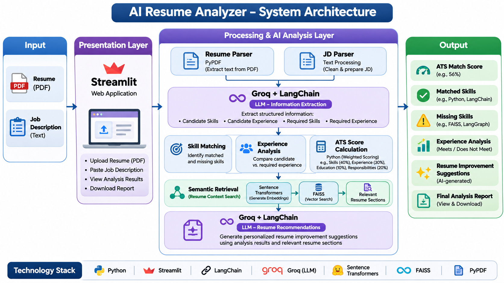

# AI Resume Analyzer

An AI-powered Resume Analyzer that compares a candidate's resume against a Job Description (JD), identifies skill gaps, calculates an indicative ATS match score, and generates AI-powered resume improvement suggestions.

## Project Objective

The objective of this project is to build a GenAI-powered application that helps candidates understand how well their resumes align with a target job description.

## Features

- Upload resume in PDF format.
- Paste a Job Description.
- Extract resume text using PyPDF.
- Extract candidate skills and experience using Groq LLM.
- Identify required and missing skills.
- Analyze candidate experience against job requirements.
- Generate an indicative ATS match score.
- Generate semantic embeddings using Sentence Transformers.
- Perform similarity search using FAISS.
- Generate AI-powered resume improvement suggestions.
- Display and download the final analysis report.

## Technology Stack

| Component | Technology |
|---|---|
| Programming Language | Python |
| Frontend | Streamlit |
| LLM | Groq |
| LLM Integration | LangChain |
| PDF Extraction | PyPDF |
| Embedding Model | BAAI/bge-small-en-v1.5 |
| Vector Database | FAISS |
| Embedding Library | Sentence Transformers |
| Configuration | Python-dotenv |

## Application Architecture

Resume PDF + Job Description
        |
        v
   Streamlit UI
        |
        v
   Resume Text Extraction
        |
        v
   Groq LLM - Skill & Experience Extraction
        |
        +--------------------------+
        |                          |
        v                          v
   Skill Comparison          Experience Analysis
        |                          |
        v                          v
   Missing Skills            Experience Match
        |                          |
        +------------+-------------+
                     |
                     v
               ATS Scoring
                     |
                     v
             AI Recommendations
                     |
                     v
                Final Report

Additional semantic retrieval flow:

Resume Text
     |
     v
Sentence Transformers
     |
     v
Embedding Generation
     |
     v
FAISS Vector Index
     |
     v
Relevant Resume Sections
     |
     v
Streamlit Results Display

## System Architecture

## Project Structure

ai-resume-analyzer/
│
├── data/
│   └── sample_resume.pdf
│
├── src/
│   ├── resume_parser.py
│   ├── jd_parser.py
│   ├── skill_extractor.py
│   ├── skill_matcher.py
│   ├── experience_analyzer.py
│   ├── ats_scorer.py
│   ├── recommendations.py
│   ├── report_generator.py
│   ├── embeddings.py
│   ├── vector_store.py
│   └── workflow.py
│
├── app.py
├── requirements.txt
├── requirements-lock.txt
├── .env
├── .env.example
├── .gitignore
└── README.md

## Setup Instructions

### 1. Clone the repository

git clone https://github.com/kiran-kumar-aidev/ai-resume-analyzer.git

cd ai-resume-analyzer

### 2. Create a virtual environment

python -m venv venv

### 3. Activate the environment

Windows PowerShell:

.\venv\Scripts\Activate.ps1

### 4. Install dependencies

pip install -r requirements.txt

### 5. Configure Groq API Key

Create a `.env` file in the project root.

GROQ_API_KEY=your_groq_api_key
GROQ_MODEL=openai/gpt-oss-120b

### 6. Run the application

streamlit run app.py

## ATS Scoring Methodology

The project uses a configurable weighted scoring formula:

| Parameter | Weight |
|---|---:|
| Required Skills Match | 40% |
| Experience Match | 30% |
| Education Match | 10% |
| Responsibility Match | 20% |

The resulting score is an indicative project-level match score. It is not an actual employer ATS score.

## How It Works

1. Candidate uploads a resume PDF.
2. Candidate provides the target Job Description.
3. PyPDF extracts resume content.
4. Groq LLM extracts candidate skills, experience, and JD requirements.
5. Python compares candidate skills with required skills.
6. Experience analyzer checks the experience requirement.
7. ATS scoring module calculates the weighted match score.
8. Sentence Transformers generates resume text embeddings.
9. FAISS retrieves semantically relevant resume sections.
10. Groq generates resume improvement recommendations.
11. Streamlit displays the analysis and provides a downloadable report.
